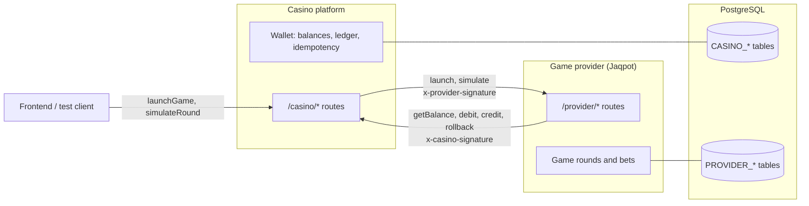
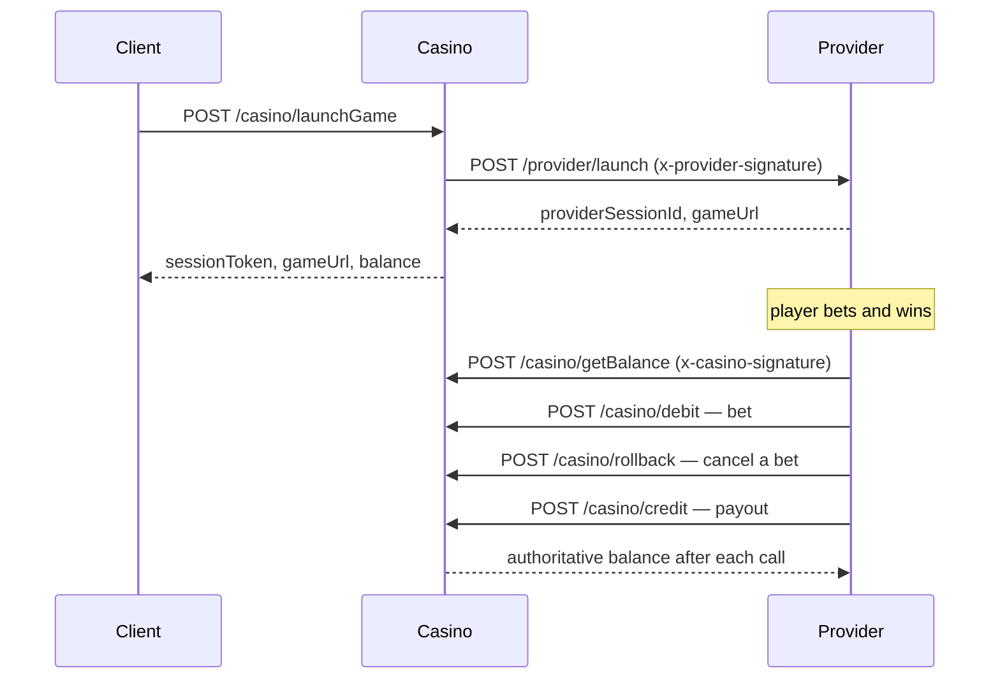

# Architecture

Two systems with a trust boundary between them. For this test they share one
codebase and one PostgreSQL database, but stay logically separated:
separate route namespaces, separate table prefixes, and no direct writes into
the other side's tables. They only talk over signed HTTP.

## Components

## A game round

## Trust rules

- The casino is the source of truth for balances. The provider never computes a
  balance; it only shows what the casino returns.
- The provider changes balances only by calling casino endpoints.
- The casino assumes provider requests can be duplicated, retried or reordered:
  every money call carries a provider-generated `transactionId` and is idempotent.
- Each direction has its own secret. The signature header names the receiver:
  `x-casino-signature` (`CASINO_SECRET`) when calling the casino,
  `x-provider-signature` (`PROVIDER_SECRET`) when calling the provider.
