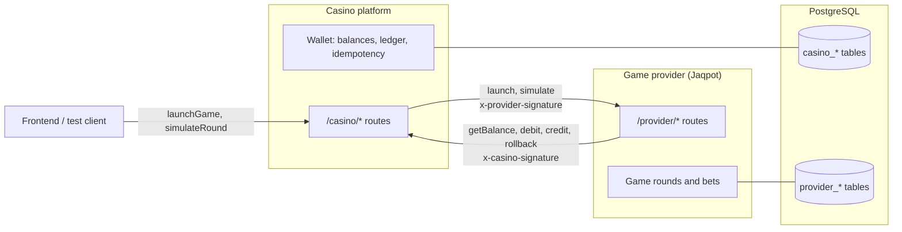
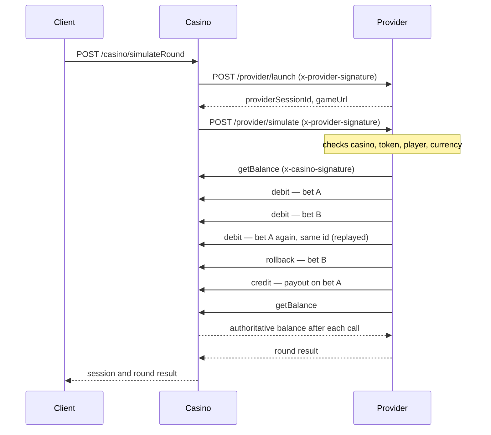

# Architecture

Two systems with a trust boundary between them. For this test they share one
codebase and one PostgreSQL database, but stay logically separated:
separate route namespaces, separate table prefixes, and no direct writes into
the other side's tables. They only talk over signed HTTP.

## Components

Table details: [database.md](database.md).

## A game round

`POST /casino/simulateRound` runs the whole flow (scripted round in
[D18](decisions.md#d18--scripted-round)):

Each provider call is stored as `PENDING` before it is sent and retried with the
same bytes on a network error or 5xx ([D16](decisions.md#d16--provider-retries-with-the-same-bytes),
[D17](decisions.md#d17--provider-records-each-call-before-sending-it)).

## Trust rules

- The casino is the source of truth for balances. The provider never computes a
  balance; it only shows what the casino returns.
- The provider changes balances only by calling casino endpoints.
- The casino assumes provider requests can be duplicated, retried or reordered:
  every money call carries a provider-generated `transactionId` and is idempotent.
- Each direction has its own secret. The signature header names the receiver:
  `x-casino-signature` (`CASINO_SECRET`) when calling the casino,
  `x-provider-signature` (`PROVIDER_SECRET`) when calling the provider.

## Every request

1. `requestContext` assigns the request id and a logger bound to it.
2. `jsonBody` parses JSON and keeps the raw bytes.
3. Signed routes run `requireCasinoSignature` or `requireProviderSignature`
   against those raw bytes.
4. Errors end in one handler that returns `{ error, message, details? }`.
