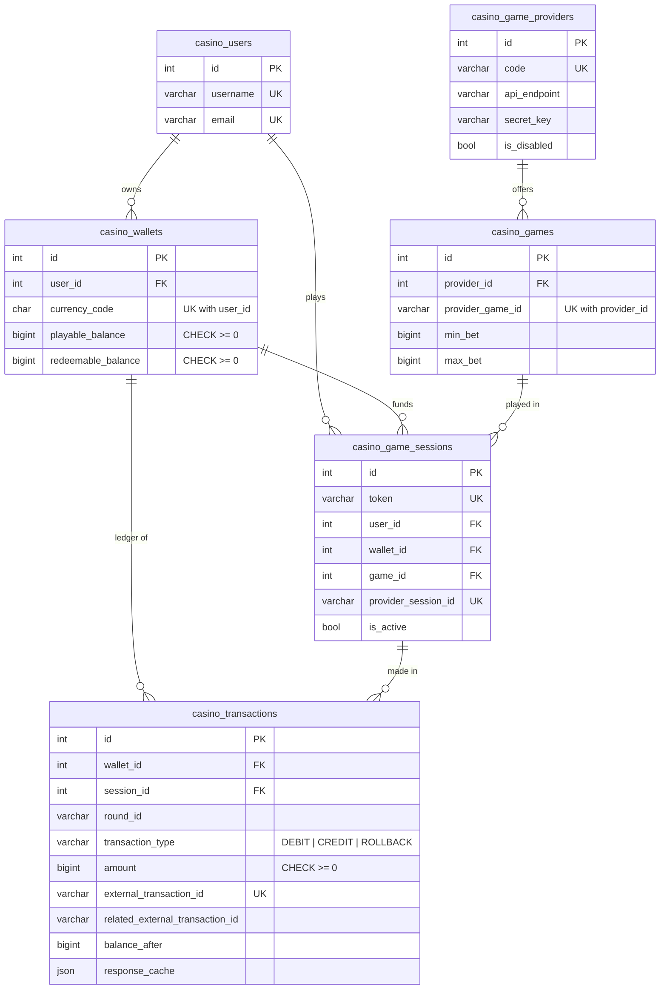
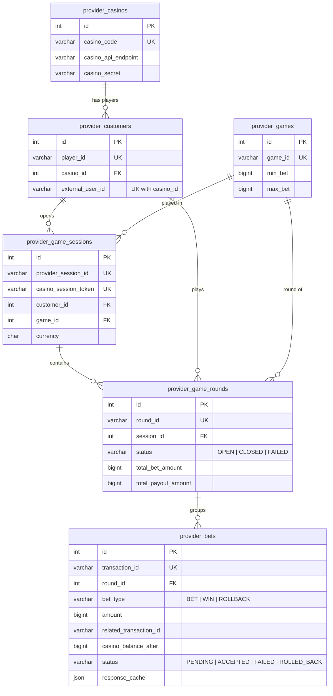

# Database

One PostgreSQL database, two domains. Casino tables are prefixed `casino_`,
provider tables `provider_`. Neither side reads or writes the other's tables;
the only link between them is the casino session token and transaction ids,
exchanged over HTTP.

Amounts are integer minor units (cents) in `BIGINT`. Migrations live in
`prisma/migrations` (`npm run db:deploy` applies them).

## Casino domain

`casino_transactions` is the ledger and the idempotency store at the same time:
the provider's transaction id is `UNIQUE`, and `response_cache` keeps the first
successful answer so a retry gets exactly the same response.

## Provider domain

`casino_balance_after` is a copy of what the casino answered, for audit. The
provider never derives a balance from its own rows.

## Constraints enforced by the database

| Table | Rule |
|---|---|
| `casino_wallets` | balances `>= 0`; one wallet per user and currency; currency is 3 upper-case letters |
| `casino_transactions` | `external_transaction_id` unique; type in `DEBIT, CREDIT, ROLLBACK`; amount and balance after `>= 0` |
| `casino_games`, `provider_games` | `min_bet > 0` and `max_bet >= min_bet` |
| `provider_bets` | `transaction_id` unique; known type and status; amount `>= 0` |
| `provider_game_rounds` | known status |

CHECK constraints are hand-written in the initial migration because Prisma's
schema language cannot express them. CI runs `prisma migrate diff` to make sure
the schema and the migrations never drift apart.
